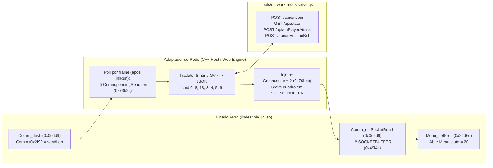

# Contrato Técnico ARM — Multi Mode, Erro 15 e Adaptador de Rede (`libdestinia_jni.so`)

> **Correção dinâmica — 26/10/2026:** as conclusões abaixo prevalecem sobre o mapeamento estático histórico das seções seguintes. O contrato anterior de login `cmd0 -> cmd8 automático` não corresponde ao ELF executado. Offsets de branches e layouts não cobertos pela prova continuam provisórios.
>
> ELF SHA-256: `f12f1d20ab42646ef81df27516851acccb9fffe7be07a054db83890d992df7e9`.
>
> Provas reproduzíveis: `tools/capture-erro15.mjs --responses` e `tools/verify-erro15-protocol.mjs`, com `DESTINIA_GAME_ROOT` apontando para o APK extraído. Dumps em `RELATORIO_VANGUARD_ERRO15_BYTES.md` e medições em `ERRO15_VERIFICACAO.json`.

## 0. Contrato comprovado por execução ARM

| Etapa | Resultado medido |
| :--- | :--- |
| Request cmd0 | 111 bytes; prefixo BE `00 00 00 6f`: tamanho total do envio. |
| Resposta cmd0 | Buffer de 34 bytes; prefixo BE `00 00 00 1e`: **4 + payload**, excluindo os próprios 4 bytes do comprimento. |
| Payload cmd0 | resultCode int32; ID string com int32 de tamanho; aviso string; **unreadMailCount int16; battleInfoCount int16**. |
| Login concluído | `Menu.state=20`, `GameUI+124=0xa0000000`, pendingSendLen=0. **Nenhum cmd8 automático.** |
| Confirmação nativa | `MainMenu_mKeyPressed(17)` produz `GameUI+124=0xa0000001`, mantendo Menu=20. Sem escrita direta no campo GameUI. |
| Request cmd8 | Solicitado explicitamente pela fixture; 53 bytes; prefixo `00 00 00 35`. Não é evidência de disparo automático. |
| Resposta cmd8 | 14 bytes; prefixo `00 00 00 0a`; resultCode int32=1 e unreadMailCount int16=0. Estados finais continuam Menu=20 e UI=0xa0000001. |
| Controle negativo | Resposta cmd0 com prefixo de tamanho total `00 00 00 22` deixa Menu=8 e não chama leitores do callback: faltam 4 bytes para o corpo que o parser espera. |

Os dois int16 são consumidos nas posições 22 e 24 do payload de teste (26 bytes). O primeiro é armazenado em netData+370 (`0x172`); o segundo em netData+590 (`0x24e`). Na execução rastreada, esse caminho escreve UI=0xa0000000 e Menu=20 em `0x235fc` e `0x23606`. Os endereços de login previamente atribuídos a `0x23900..0x2395a` não sustentam o fluxo alegado para este ELF.

A confirmação do slot exige a fixture de seleção pronta (`Menu+164=4`) e nível não zero. `GameCanvas_LoadGame` é interceptado para retornar sucesso em RAM: **não é validação de save real nem de personagem persistido**. A prova independente bloqueia `GameCanvas_SaveGame` e confirma zero chamadas. Os hosts, o binário ARM, os saves reais, a release e o site não foram alterados.

---

> **Status histórico (não equivale a validação dinâmica):** Mapeamento estático do binário original `game/lib/armeabi/libdestinia_jni.so` (somente leitura) confrontado com `host/main.cpp`, `host_zoom/main.cpp`, `web/dist/engine.mjs` e `tools/network-mock/server.js`.
> **Escopo:** Documentar com precisão de instruções ARM/Thumb e offsets de memória a origem exata do `Codigo de Erro = 15`, o protocolo binário da camada `Comm_*`, a máquina de estados de `Menu_netProc` (`0x22d6d`) e a arquitetura de adaptador seguro para conectar o motor ARM ao servidor mock (`tools/network-mock`).

---

## 1. Resumo Executivo

1. **Causa exata de `"Ocorreu um erro de rede. Codigo de Erro = 15"`:**
   - Quando o jogador seleciona **MULTI MODE** no menu principal (`Menu.state = 1 -> 8`) e confirma um personagem válido em `MenuCanvas_mKeyPressed` (`0x22c36`), o jogo carrega o save do slot escolhido (`GameCanvas_LoadGame`), inicializa um pacote de rede com `Comm_setConType(0)` (`0x22c84`) e `Comm_init(0)` (`0x22c8a`, comando `0` = Login Multi Mode), escreve **58 bytes** de payload do herói e chama `Comm_flush()` (`0x22cc6` -> `0x0edd8`).
   - `Comm_flush()` ativa o estado de espera de rede chamando `MMain_setNetState(1)` (`MMain + 0x3920 = 1`, `MMain + 0x3924 = 0`), monta o quadro binário de **111 bytes** (53 bytes de cabeçalho GV + 58 bytes de payload) em `Comm + 52` (`0x70bd0`) e publica `111` em `Comm.pendingSendLen` (`Comm + 0x2f90` = `0x73b2c`).
   - No APK Android original, a thread Java `CommManager` consome esse pacote chamando `Java_game_destiniaeng_CommManager_commCheck` (`0x07bed`), transmite via HTTP/socket para `211.233.59.35:8990`, injeta a resposta com `Java_game_destiniaeng_GameThread_procCommRead` (`0x07b4d`) e notifica `Java_game_destiniaeng_GameThread_procCommMsg` (`0x07c4d` -> `Comm_resultCB`).
   - Como **nem os hosts C++ (`host/main.cpp`, `host_zoom/main.cpp`) nem o motor Web (`web/dist/engine.mjs`) chamam `commCheck`, `procCommRead` ou `procCommMsg`**, `MMain.netState` permanece em `1`.
   - A cada frame, `MMain_run` (`0x1040c`) incrementa `MMain.netTimer` (`MMain + 0x3924`) em `0x10456`. Quando `MMain.netTimer` ultrapassa **150 frames** (`0x96`, ~5 a 7,5 segundos) para `Comm.conType == 0` (`0x10478..0x10486`), `MMain_run` executa `Comm_close()`, define `Comm.retryCount = 10` (`0x1049c`), carrega **`r0 = 15` (`0x104b6: movs r0, #15`)**, `r1 = 0` e invoca `Comm.processCB(15, 0)` -> **`Menu_netProc(15, 0)`** (`0x104b8`).
   - `Menu_netProc(15, 0)` (`0x22d6c`) detecta `r0 != 0` (`0x22dc4 -> 0x22ee6`), formata `sprintf(netData + 260, formatStr, 15)` (`0x22f0e`) com a string de `MMain + 0x824` (`"A network error has occurred.\nError Code = %d"`, traduzida por `common/portuguese_text.h` e `web/src/portuguese-text.mjs` para `"Ocorreu um erro de rede.\nCodigo de Erro = %d"`), zera a struct `Game` (`0x22f42`), chama `MMain_setNetState(2)` (`0x22f56`) e exibe o popup modal sobre a tela de seleção de personagem (`Menu.state == 8`).

2. **Transição comprovada para o Menu Online:** a resposta cmd0 já traz unreadMailCount e battleInfoCount e produz Menu=20/UI=0xa0000000. A confirmação nativa abre UI=0xa0000001. cmd8 foi testado como operação explícita; não foi disparado automaticamente. Ver seção 0.

---

## 2. Tabela de Símbolos ELF e Estruturas Globais (`SO_BASE = 0x10000000`)

Todos os deslocamentos abaixo são relativos à base do módulo `libdestinia_jni.so` (`SO_BASE = 0x10000000` nos emuladores Unicorn C++ e Web).

### 2.1. Funções JNI e de Rede (`Comm_*`, `MMain_*`, `Menu*`)

| Símbolo ELF | Offset (`.so`) | Endereço (`SO_BASE+off`) | Tam. | Papel no Contrato |
| :--- | :--- | :--- | :--- | :--- |
| `Java_game_destiniaeng_CommManager_commGetConType` | `0x079a9` | `0x100079a9` | 20 B | Retorna `*(uint32_t*)(Comm + 28)` (`Comm.conType`). |
| `Java_game_destiniaeng_GameThread_procCommRead` | `0x07b4d` | `0x10007b4d` | 160 B | Copia um `jbyteArray` recebido para `SOCKETBUFFER + curSocketPos` (`0x49f4c + *0x45108`) e soma `len` em `curSocketPos`. |
| `Java_game_destiniaeng_CommManager_commCheck` | `0x07bed` | `0x10007bed` | 96 B | Lê `len = *(int32_t*)(Comm + 0x2f90)`, zera `*(int32_t*)(Comm + 0x2f90) = 0` e, se `len > 0`, copia `len` bytes de `Comm + 52` (`0x34`) para o `jbyteArray` Java e retorna `len`. |
| `Java_game_destiniaeng_GameThread_procCommMsg` | `0x07c4d` | `0x10007c4d` | 14 B | Wrapper JNI que chama `Comm_resultCB(msgType, errCode, 0)`. |
| `Java_game_destiniaeng_GameThread_setUniqueID` | `0x07d6d` | `0x10007d6d` | 48 B | Copia o identificador único do aparelho para `Comm + 0x31bc` (`40` bytes). |
| `Java_game_destiniaeng_GameThread_initGame` | `0x07dd9` | `0x10007dd9` | 180 B | Inicializa `Comm.uniqueID` (`+0x31bc`), `Comm.modelName` (`+0x319c`), heap e entra em `MMain_init()`. |
| `Java_game_destiniaeng_GameThread_jniRun` | `0x07ef9` | `0x10007ef9` | 12 B | Chama `MMain_run()` (`0x1040c`) a cada tick do loop principal. |
| `MC_netSocketRead` | `0x086c1` | `0x100086c1` | 72 B | Consome até `r2` bytes do início de `SOCKETBUFFER` (`0x49f4c`), desloca o restante com `memcpy` e decrementa `curSocketPos` (`0x45108`). |
| `Comm_SetProcessCB` | `0x0e5f5` | `0x1000e5f5` | 20 B | Define `*(uint32_t*)(Comm + 0) = r0` (`Comm.processCB`). |
| `Comm_write8Bytes` | `0x0e685` | `0x1000e685` | 84 B | Escreve `int64 BE` em `outPacket.data + outPacket.writePos` e soma `8`. |
| `Comm_write4Bytes` | `0x0e6d9` | `0x1000e6d9` | 56 B | Escreve `int32 BE` em `outPacket.data + outPacket.writePos` e soma `4`. |
| `Comm_write2Bytes` | `0x0e711` | `0x1000e711` | 40 B | Escreve `int16 BE` em `outPacket.data + outPacket.writePos` e soma `2`. |
| `Comm_writeBytes` | `0x0e739` | `0x1000e739` | 52 B | Copia `r1` bytes brutos para `outPacket.data + outPacket.writePos`. |
| `Comm_write` | `0x0e76d` | `0x1000e76d` | 32 B | Escreve `uint8` em `outPacket.data + outPacket.writePos` e soma `1`. |
| `Comm_readAvail` | `0x0e78d` | `0x1000e78d` | 36 B | Retorna `inPacket.packetLen - inPacket.readPos` (ou `0` se `< 0`). |
| `Comm_read` | `0x0e7b1` | `0x1000e7b1` | 32 B | Lê `uint8` de `inPacket.data + inPacket.readPos` e soma `1`. |
| `Comm_read2Bytes` | `0x0e7d1` | `0x1000e7d1` | 40 B | Lê `int16 BE` (com sinal) de `inPacket.data + inPacket.readPos` e soma `2`. |
| `Comm_read4Bytes` | `0x0e7f9` | `0x1000e7f9` | 48 B | Lê `int32 BE` de `inPacket.data + inPacket.readPos` e soma `4`. |
| `Comm_read8Bytes` | `0x0e829` | `0x1000e829` | 128 B | Lê `int64 BE` de `inPacket.data + inPacket.readPos` e soma `8`. |
| `Comm_readBytes` | `0x0e8a9` | `0x1000e8a9` | 52 B | Copia `r1` bytes de `inPacket.data + inPacket.readPos` para `r0`. |
| `Comm_readStr` | `0x0e8dd` | `0x1000e8dd` | 92 B | Lê `len = Comm_read4Bytes()` (`int32 BE`), copia `len` bytes (truncando em `maxLen` se `r1 > 0`) e grava `\0` no final. |
| `Comm_init` | `0x0e939` | `0x1000e939` | 68 B | Zera `Comm.sendLen` (`Comm+48`), zera `inPacket` (`12012` B) e `outPacket` (`12008` B) e define `outPacket.command = r0` (`outPacket+4`). |
| `Comm_resultCB` | `0x0e97d` | `0x1000e97d` | 348 B | Callback central de eventos de rede (`msgType`, `errCode`, `arg2`). |
| `Comm_netSocketRead` | `0x0ead9` | `0x1000ead9` | 636 B | Máquina de leitura que consome `SOCKETBUFFER` via `MC_netSocketRead`, monta `inPacket` e dispara `Comm_resultCB(3, 0, 0)`. |
| `Comm_mRun` | `0x0ed55` | `0x1000ed55` | 32 B | Chamado em todo frame por `MMain_run`; se `Comm.state == 2` (`Comm+32 == 2`), chama `Comm_netSocketRead()`. |
| `Comm_flush` | `0x0edd9` | `0x1000edd9` | 308 B | Empacota `outPacket` em `Comm.sendBuf` (`Comm+52`), publica o tamanho em `Comm.pendingSendLen` (`Comm+0x2f90`) e chama `MMain_setNetState(1)`. |
| `Comm_reflush` | `0x0ef0d` | `0x1000ef0d` | 112 B | Reenvia o buffer já montado em `Comm+52` (até 2 retentativas quando `Comm.retryCount < 0`). |
| `Comm_close` | `0x0ef7d` | `0x1000ef7d` | 60 B | Fecha o socket/conexão atual e zera `Comm.state = 0` (`Comm+32`). |
| `Comm_setConType` | `0x0efb9` | `0x1000efb9` | 44 B | Define `Comm.conType = r0` (`Comm+28`), fechando a conexão anterior se `Comm.state != 0`. |
| `Comm_writeString` | `0x0f109` | `0x1000f109` | 116 B | Escreve `len` como `int32 BE` seguido dos bytes da string em `outPacket`. |
| `MMain_setNetState` | `0x0f27d` | `0x1000f27d` | 28 B | Define `*(uint16_t*)(MMain + 0x3920) = r0` e zera `*(uint32_t*)(MMain + 0x3924) = 0`. |
| `MMain_drawNetLoading` | `0x0f5f5` | `0x1000f5f5` | 172 B | Desenha o indicador animado de espera de rede quando `MMain.netState == 1`. |
| `MMain_run` | `0x1040d` | `0x1001040d` | 240 B | Tick global: chama `Comm_mRun()`, gerencia `MMain.netTimer` e dispara `Menu_netProc(15, 0)` no timeout de 150 frames. |
| `MenuCanvas_mPaint` | `0x21db5` | `0x10021db5` | 888 B | Renderiza o menu principal, seleção de personagens (`state 2`/`8`), menu Multi Mode (`state 20`) e popups de rede (`netState 1`/`2`/`3`). |
| `MenuCanvas_init` | `0x2212d` | `0x1002212d` | 400 B | Inicializa `MenuCanvas`, registra `Comm_SetProcessCB(Menu_netProc)` (`0x22226`) e chama `_makeNetMenu(0xa0000001)` (`0x22298`). |
| `MenuCanvas_mKeyPressed` | `0x227d9` | `0x100227d9` | 1424 B | Trata teclas do menu principal, seleção de personagem do Multi Mode (`0x22c36`) e delega o estado `20` para `MainMenu_mKeyPressed`. |
| `Menu_netProc` | `0x22d6d` | `0x10022d6d` | 3492 B | Callback central (`Comm.processCB`) que processa erros (`r0 != 0`) e todas as respostas de rede (`r0 == 0`, `r1 = &inPacket`). |
| `_makeNetMenu` | `0x25b21` | `0x10025b21` | 1004 B | Constrói as strings dinâmicas do menu Multi Mode (`0xa0000001`), Hall of Honor (`0xa4000002` / `0xa4000003`) e detalhes. |
| `GameUI_drawMainMenu` | `0x31df9` | `0x10031df9` | 1916 B | Desenha a UI de menus (incluindo `0xa0000000..0xa5ffffff`: `_drawNetMenu`, `_drawNetBattleMenu`, `_drawNetRankMenu`, `_drawNetPostMenu`, `_drawNetBuyMenu`). |
| `MainMenu_mKeyPressed` | `0x35dbd` | `0x10035dbd` | 23808 B | Trata a navegação no menu Multi Mode (`0xa0000001`) e subtelas online, disparando `Comm_init(1..18)` + `Comm_flush()`. |

---

### 2.2. Layout das Estruturas Globais em BSS

#### `SOCKETBUFFER` (`0x49f4c`, 20.480 bytes) e `curSocketPos` (`0x45108`, 4 bytes)
- `0x45108` (`curSocketPos`, `int32`): quantidade de bytes atualmente armazenados em `SOCKETBUFFER` aguardando leitura por `MC_netSocketRead`.
- `0x49f4c` (`SOCKETBUFFER`, `uint8[20480]`): fila FIFO alimentada por `Java_game_destiniaeng_GameThread_procCommRead` e consumida por `Comm_netSocketRead` via `MC_netSocketRead`.

#### `inPacket` (`0x6adc8`, 12.012 bytes = `0x2eec`)
| Offset | Campo | Tipo | Descrição |
| :--- | :--- | :--- | :--- |
| `+0` (`0x00`) | `readPos` | `int32` | Cursor atual de leitura em `data` (incrementado por `Comm_read*`). |
| `+4` (`0x04`) | `packetLen` | `int32` | Tamanho útil do payload em bytes (`totalLen - 4` no modo `conType == 0`). |
| `+8` (`0x08`) | `command` | `int32` | Código do comando recebido (`0..18`, `0x20a..0x20f`, `0x402..0x403`). |
| `+12` (`0x0c`) | `data[12000]` | `uint8[12000]` | Payload bruto lido por `Comm_read*`. |

#### `outPacket` (`0x6dcb4`, 12.008 bytes = `0x2ee8`)
| Offset | Campo | Tipo | Descrição |
| :--- | :--- | :--- | :--- |
| `+0` (`0x00`) | `writePos` | `int32` | Quantidade de bytes escritos em `data` (incrementado por `Comm_write*`). |
| `+4` (`0x04`) | `command` | `int32` | Código do comando de saída definido em `Comm_init(cmd)`. |
| `+8` (`0x08`) | `data[12000]` | `uint8[12000]` | Payload de saída acumulado antes de `Comm_flush()`. |

#### `Comm` (`0x70b9c`, 12.824 bytes = `0x3218`)
| Offset | Campo | Tipo | Descrição |
| :--- | :--- | :--- | :--- |
| `+0` (`0x0000`) | `processCB` | `uint32` (fn ptr) | Callback de rede: `Menu_netProc` (`0x10022d6d`), registrado em `MenuCanvas_init` (`0x22226`). |
| `+24` (`0x0018`) | `socketHandle` | `int32` | Handle de socket nativo (quando aplicável). |
| `+28` (`0x001c`) | `conType` | `int32` | Tipo de conexão: `0` = Multi Mode GV (`211.233.59.35:8990`), `10` = Billing/GV Auth (`211.233.59.38:8666`), `11` = Socket direto, `30` = T-Cash. |
| `+32` (`0x0020`) | `state` | `int32` | Estado do canal: `0` = inativo, `2` = conectado/apto a ler `SOCKETBUFFER` em `Comm_mRun`. |
| `+36` (`0x0024`) | `retryCount` | `int32` | Contador de retentativas (`-2..0` para retentativa via `Comm_reflush`; `10` no timeout de `MMain_run`). |
| `+40` (`0x0028`) | `readStage` | `int32` | Estágio interno da máquina de estados `Comm_netSocketRead` (`0` = lendo cabeçalho, `1` = lendo corpo). |
| `+44` (`0x002c`) | `lastCmd` | `int32` | Último comando enviado por `Comm_flush()` (cópia de `outPacket.command`). |
| `+48` (`0x0030`) | `sendLen` | `int32` | Tamanho total em bytes do pacote montado em `sendBuf`. |
| `+52` (`0x0034`) | `sendBuf[12000]` | `uint8[12000]` | Quadro binário completo pronto para envio. |
| `+12068` (`0x2f24`) | `recvProgress` | `int32` | Bytes acumulados no estágio atual de `Comm_netSocketRead`. |
| `+12072` (`0x2f28`) | `recvTotalBytes` | `int32` | Contador auxiliar de bytes recebidos. |
| `+12076` (`0x2f2c`) | `recvHdrBuf[8]` | `uint8[8]` | Buffer de 8 bytes do cabeçalho de resposta (`[totalLen BE][command BE]`). |
| `+12176` (`0x2f90`) | `pendingSendLen` | `int32` | **Sinalizador para `commCheck`:** `> 0` quando há pacote pronto em `sendBuf`; zerado por `commCheck`. |
| `+12680` (`0x3188`) | `myNetId[20]` | `char[20]` | Nickname/ID online do jogador (exibido como `"MY ID : %s"` no menu Multi Mode e tela VS). |
| `+12700` (`0x319c`) | `modelName[32]` | `char[32]` | Modelo do dispositivo (`"DestiniaPC"` nos hosts C++). |
| `+12732` (`0x31bc`) | `uniqueID[40]` | `char[40]` | Identificador do dispositivo (`"000000000000000"` nos hosts C++). |

#### `MMain` (`0x73dc0`, 14.632 bytes = `0x3928`)
| Offset | Campo | Tipo | Descrição |
| :--- | :--- | :--- | :--- |
| `+0` (`0x0000`) | `currentCanvas` | `uint32` | Ponteiro para o canvas ativo (`LogoCanvas`, `MenuCanvas`, `GameCanvas`). |
| `+2084` (`0x0824`) | `errFormatStr` | `char*` | Ponteiro para string de `gametxt_en.tdt` índice 77: `"A network error has occurred.\nError Code = %d"`. |
| `+14596` (`0x3904`) | `loadingFrame` | `uint32` | Frame (`0..7`) do spinner de rede em `MMain_drawNetLoading`. |
| `+14624` (`0x3920`) | `netState` | `uint16` | `0` = normal, `1` = aguardando rede (spinner + bloqueio de input + timer), `2` = popup de erro (`netData+260`), `3` = popup de aviso (`GameUI_drawNetNotice`). |
| `+14628` (`0x3924`) | `netTimer` | `uint32` | Contador de frames enquanto `netState == 1`. **Estoura em `> 150` frames (`conType == 0`) gerando o Erro 15.** |

#### `Menu` (`0x83ac0`, 532 bytes = `0x214`)
| Offset | Campo | Tipo | Descrição |
| :--- | :--- | :--- | :--- |
| `+156` (`0x9c`) | `state` | `uint32` | `1` = Menu Principal, `2` = Seleção Single Mode, `8` = **Seleção de Personagem Multi Mode**, `9` = Popup Slot Vazio, `20` = **Menu Online Multi Mode** (`GameUI_drawMainMenu`). |
| `+184` (`0xb8`) | `slotLevel[3]` | `uint16[3]` | Nível dos personagens nos slots `0..2` (`0` se o slot estiver vazio). |
| `+190` (`0xbe`) | `selectedSlot` | `uint16` | Índice do slot selecionado (`0..2`). |
| `+204` (`0xcc`) | `cursor` | `uint16` | Item selecionado no Menu Principal (`0` = Single Mode, `1` = Multi Mode, `2` = Options, `3` = Help, `4` = About). |

#### `netData` (`0x81bf4`, 7.884 bytes = `0x1ecc`)
| Offset | Campo | Tipo | Descrição |
| :--- | :--- | :--- | :--- |
| `+0` (`0x0000`) | `noticeText[200]` | `char[200]` | Texto do aviso do servidor lido no login (`cmd = 0`), exibido no rodapé e na aba `Notice`. |
| `+260` (`0x0104`) | `errorMsg[100]` | `char[100]` | Mensagem de erro exibida por `GameUI_drawOkPopup2` quando `MMain.netState == 2`. |
| `+370` (`0x0172`) | `unreadMailCount` | `uint16` | Quantidade de mensagens na caixa de entrada (`"Mailbox[%d]"`), lida no `cmd = 8`. |
| `+590` (`0x024e`) | `battleInfoCount` | `uint16` | Quantidade de registros de defesa PvP (`"Battle Info[%d]"`), lida no `cmd = 0`. |

#### `Game` (`0x77ee0`, 32.056 bytes = `0x7d38`) e `GameUI` (`0x7fbe8`, 8.204 bytes = `0x200c`)
- `Game + 0x4886` (`18566`, `uint16`): slot/índice do personagem carregado (`0..2`).
- `Game + 0x4888` (`18568`, `uint16`): classe do personagem (`heroClass`).
- `Game + 0x488a` (`18570`, `uint32`): pontos de honra (`honorPoints`).
- `Game + 0x488e` (`18574`, `uint16`): vitórias PvP (`winCount`).
- `Game + 0x4890` (`18576`, `uint16`): derrotas PvP (`loseCount`).
- `Game + 0x48fa` (`18682`, `uint16`): nível atual do herói (`heroLevel`).
- `Game + 0x49a0` (`18848`, `uint32`): `netUserId` persistido no save do personagem.
- `GameUI + 124` (`0x7c`, `uint32`): ID da tela/menu de UI ativa (`0xa0000001` = Menu Principal Multi Mode, `0xa1000002` = Notice, `0xa2000002` = Battle Arena, `0xa3000004` = Battle Info, `0xa4000002` = Hall of Honor, `0xa4000004` = Mailbox, `0xa4000005` = Auction Hall).

---

## 3. Fluxo Passo a Passo: Da Seleção de "MULTI MODE" ao `Codigo de Erro = 15`

```mermaid
sequenceDiagram
    participant User as Jogador
    participant Menu as MenuCanvas_mKeyPressed (0x227d9)
    participant Comm as Comm_init / Comm_flush (0x0edd9)
    participant Loop as MMain_run (0x1040d)
    participant CB as Menu_netProc (0x22d6d)

    User->>Menu: Seleciona MULTI MODE (Menu.state=1, cursor=1)
    Menu->>Menu: 0x22aa4: Carrega níveis dos slots 0..2 e define Menu.state = 8
    User->>Menu: Confirma personagem no slot N (Menu.state=8, key=6/17)
    Menu->>Menu: 0x22c36: memset(netData, 0, 0x1ecc) + GameCanvas_LoadGame(slot, 0)
    Menu->>Comm: 0x22c84: Comm_setConType(0) + Comm_init(0)
    Menu->>Comm: 0x22c90..0x22cc0: Escreve 58 bytes (slot, class, level, netUserId, 24x cash)
    Menu->>Comm: 0x22cc6: Comm_flush()
    Comm->>Loop: MMain_setNetState(1) (netState=1, netTimer=0)
    Comm->>Comm: Monta 111 bytes em Comm+52 e grava Comm+0x2f90 = 111
    Note over Comm,Loop: Host C++ / Web não polla commCheck() nem chama procCommRead/procCommMsg
    loop Frames 1..150 (MMain_run @ 0x10456)
        Loop->>Loop: MMain.netTimer++ (spinner MMain_drawNetLoading)
    end
    Note over Loop: Frame 151: netTimer (151) > 150 (0x10484: cmp r3, r2; bgt)
    Loop->>Comm: 0x10488: Comm_close() + Comm.retryCount = 10
    Loop->>CB: 0x104b6: movs r0, #15; movs r1, #0; blx Menu_netProc(15, 0)
    CB->>CB: 0x22f0e: sprintf(netData+260, "Ocorreu um erro de rede.\nCodigo de Erro = %d", 15)
    CB->>CB: 0x22f42: memset(&Game, 0, 0x7d38) + setMyGold(0)
    CB->>Loop: 0x22f56: MMain_setNetState(2) (exibe popup de erro sobre Menu.state=8)
```

### Detalhamento por Endereço ARM/Thumb

1. **Entrada na Seleção de Personagem Multi Mode (`0x22aa4..0x22cf8`):**
   - Em `MenuCanvas_mKeyPressed` (`0x227d9`), quando `Menu.state == 1` e `Menu.cursor == 1` (**MULTI MODE**), pressionar Confirmar desvia para `0x22aa4`.
   - O laço em `0x22ab0..0x22ad2` chama `GameCanvas_LoadGame(slot, &Menu.slotLevel[slot])` para os slots `0`, `1` e `2`, preenchendo `Menu + 184..188` com o nível de cada herói.
   - Em `0x22cf6..0x22cf8`, define `Menu.state = 8` (`movs r2, #8; str r2, [r3, #156]`).
   - Nota: em `Menu.state == 8`, pressionar o botão de ação secundário (`key == 27`) para um slot vazio **não** abre a criação de personagem (que só existe em `Menu.state == 2`, Single Mode); o Multi Mode exige um personagem já criado no Single Mode.

2. **Confirmação do Personagem e Envio do Login (`cmd = 0`, `0x229fe..0x22cc6`):**
   - Em `Menu.state == 8`, ao pressionar Confirmar (`key == 6` ou `17`), `0x22a04` verifica `Menu.slotLevel[Menu.selectedSlot] != 0`.
   - Se o slot for vazio (`0`), muda para `Menu.state = 9` (`0x22a1c`), exibindo o aviso de que é necessário criar um personagem no Single Mode primeiro.
   - Se o slot tiver personagem (`!= 0`), salta para `0x22c36`:
     - `0x22c4a`: `memset(netData, 0, 0x1ecc)` — limpa toda a estrutura `netData` (`0x81bf4`).
     - `0x22c50..0x22c60`: grava `Menu.selectedSlot` em `mainSaveData + 2` e chama `MMain_SaveData()`.
     - `0x22c6a`: chama `GameCanvas_LoadGame(Menu.selectedSlot, 0)` para carregar o herói completo em `Game` (`0x77ee0`).
     - `0x22c84`: chama `Comm_setConType(0)` (`Comm.conType = 0`).
     - `0x22c8a`: chama `Comm_init(0)` (`outPacket.command = 0`).
     - `0x22c94`: `Comm_write2Bytes(*(uint16_t*)(Game + 0x4886))` (`charSlot`).
     - `0x22c9a`: `Comm_write2Bytes(*(uint16_t*)(Game + 0x4888))` (`heroClass`).
     - `0x22ca0`: `Comm_write2Bytes(*(uint16_t*)(Game + 0x48fa))` (`heroLevel`).
     - `0x22ca8`: `Comm_write4Bytes(*(uint32_t*)(Game + 0x49a0))` (`netUserId`).
     - `0x22cb2..0x22cc2`: laço de 24 iterações chamando `Comm_write2Bytes` para os 24 inteiros de 16 bits em `0x776e8` (`48` bytes de histórico de itens cash).
     - `0x22cc6`: chama `Comm_flush()`.

3. **Empacotamento em `Comm_flush` (`0x0edd8..0x0ef0a`):**
   - `0x0ede4`: chama `MMain_setNetState(1)` -> define `MMain.netState = 1` e `MMain.netTimer = 0`.
   - `0x0edee..0x0edf6`: copia `outPacket.command` (`0`) para `Comm.lastCmd` (`Comm + 44`) e inicia `Comm.sendLen = 53` (`0x35`).
   - Como `Comm.conType == 0`, monta o cabeçalho binário Gamevil de **53 bytes** em `Comm.sendBuf` (`Comm + 52` = `0x70bd0`):
     - `+0..+3` (`4` B): tamanho total do quadro em **Big-Endian** (`58 + 53 = 111 = 0x0000006F`).
     - `+4..+7` (`4` B): `outPacket.command` em **Big-Endian** (`0x00000000`).
     - `+8..+11` (`4` B): constante `2592` (`0x00000A20` em **Big-Endian**, game ID da Gamevil).
     - `+12` (`1` B): versão (`0x01`).
     - `+13..+32` (`20` B): `Comm.uniqueID` (`Comm + 0x31bc`, `20` bytes).
     - `+33..+52` (`20` B): `Comm.modelName` (`Comm + 0x319c`, `20` bytes).
   - `+53..+110` (`58` B): copia os `58` bytes de `outPacket.data`.
   - `0x0eef8`: grava `111` (`0x6f`) em `Comm.pendingSendLen` (`Comm + 0x2f90` = `0x73b2c`), zera `curSocketPos = 0` (`0x45108`) e encerra.

4. **Estouro de Timeout em `MMain_run` (`0x1040c..0x104be`):**
   - Enquanto `MMain.netState == 1`:
     - `0x10454..0x10458`: `MMain.netTimer = MMain.netTimer + 1`.
     - `0x10474..0x10486`: verifica `Comm.conType` (`*(int32_t*)(Comm + 28)`). Para `conType != 30`, carrega `r2 = 150` (`0x96`) e compara `cmp r3, r2` (`netTimer > 150`).
     - No **frame 151**, `bgt` não desvia e executa o bloco de timeout (`0x10488..0x104ba`):
       - `0x10488`: `bl Comm_close` (`0x0ef7c`).
       - `0x1049a..0x1049c`: `movs r1, #10; str r1, [r4, #36]` (`Comm.retryCount = 10`, impedindo retentativas em `Menu_netProc`).
       - `0x104b4`: `ldr r3, [r4, #0]` (`r3 = Comm.processCB = Menu_netProc`).
       - `0x104b6`: **`movs r0, #15`** (`errCode = 15`, `movs r1, #0`).
       - `0x104b8`: **`blx r3`** -> chama `Menu_netProc(15, 0)`.

5. **Formatação da Mensagem em `Menu_netProc` (`0x22d6c..0x22f5c`):**
   - `0x22dc4`: `cmp r0, #0; bne 0x22ee6` (fluxo de erro quando `r0 != 0`).
   - `0x22ee6..0x22ef0`: incrementa `Comm.retryCount` (`10 -> 11`); como `11 >= 0`, não chama `Comm_reflush()`.
   - `0x22efe..0x22f0e`: chama `sprintf(netData + 260, *(char**)(MMain + 0x824), 15)`, gravando `"Ocorreu um erro de rede.\nCodigo de Erro = 15"` em `netData + 260` (`0x81cf8`).
   - `0x22f3c..0x22f56`: como `Comm.lastCmd == 0`, zera `Game` (`memset(0x77ee0, 0, 0x7d38)`), chama `setMyGold(0)` e chama `MMain_setNetState(2)` (`MMain.netState = 2`), exibindo a caixa de diálogo de erro com botão OK.

---

## 4. Contrato Binário de `Comm_netSocketRead` e `Comm_resultCB`

Para que o motor ARM processe qualquer resposta de rede no modo Multi Mode (`Comm.conType == 0`), a ponte do host precisa seguir exatamente o protocolo esperado por `Comm_resultCB` (`0x0e97d`) e `Comm_netSocketRead` (`0x0ead9`):

### 4.1. Sequência de Eventos JNI Esperada pelo Binário ARM

1. **Coleta da Requisição (`commCheck`):**
   - O host verifica `Java_game_destiniaeng_CommManager_commCheck` (`0x07bed`) ou lê diretamente `Comm.pendingSendLen` (`*(int32_t*)(0x10073b2c)`).
   - Quando `pendingSendLen > 0`:
     - O quadro de saída está em `Comm.sendBuf` (`0x10070bd0`, tamanho `pendingSendLen` bytes).
     - Para `Comm.conType == 0`, os bytes do quadro de saída são:
       - `sendBuf[0..3]`: `int32 BE` = `53 + payloadLen` (tamanho total do quadro de saída).
       - `sendBuf[4..7]`: `int32 BE` = `command` (mesmo valor de `Comm.lastCmd` em `0x10070bc8`).
       - `sendBuf[8..52]`: cabeçalho GV de 45 bytes (`0x00000A20`, `0x01`, `uniqueID[20]`, `modelName[20]`).
       - `sendBuf[53..pendingSendLen-1]`: payload do comando escrito por `Comm_write*`.
     - `commCheck` zera `Comm.pendingSendLen = 0`.

2. **Injeção da Resposta (`procCommMsg` + `procCommRead`):**
   - Existem duas formas equivalentes e seguras de entregar a resposta ao código ARM:
   - **Via funções JNI nativas (fluxo idêntico ao Android):**
     1. Chamar `Java_game_destiniaeng_GameThread_procCommMsg(env, thiz, 1, 0)` (ou `Comm_resultCB(1, 0, 0)` em `0x1000e97d`), o que define `Comm.state = 2` (`*(int32_t*)(0x10070bbc) = 2`, log `"CONNECT SUCCESS!!!!!!!!"`).
     2. Empacotar a resposta no formato de quadro de entrada de `Comm_netSocketRead` (`conType == 0`):
        - `respHdr[0..3]`: `int32 BE` = `responsePayloadLen + 4` (tamanho do payload + 4 bytes do campo `command`).
        - `respHdr[4..7]`: `int32 BE` = `command` (código do comando respondido, ex.: `0`, `8`, `4`, etc.).
        - `respBody[0..responsePayloadLen-1]`: bytes do payload de resposta.
     3. Entregar os `8 + responsePayloadLen` bytes chamando `Java_game_destiniaeng_GameThread_procCommRead` (`0x10007b4d`) — ou copiando para `SOCKETBUFFER + curSocketPos` (`0x10049f4c + *0x10045108`) e somando `8 + responsePayloadLen` em `curSocketPos` (`0x10045108`).
     4. No próximo `MMain_run()`, `Comm_mRun()` (`0x0ed55`) vê `Comm.state == 2` e chama `Comm_netSocketRead()` (`0x0ead9`), que lê os 8 bytes de cabeçalho + `responsePayloadLen` bytes de corpo de `SOCKETBUFFER`, preenche `inPacket` (`0x1006adc8`) e invoca automaticamente `Comm_resultCB(3, 0, 0)` -> `Menu_netProc(0, &inPacket)`.

---

## 5. Tabela Completa de Comandos de `Menu_netProc` (`0x22d6d`)

Quando `Comm_resultCB(3, 0, 0)` chama `Menu_netProc(0, &inPacket)`:
- `Menu_netProc` lê primeiro **`resultCode = Comm_read4Bytes()` (`int32 BE`)** em `0x22de8`.
- Despacha em `switch (inPacket.command)` (`0x22df8..0x22ee0`):

| `cmd` | Nome / Tela | Requisição (`outPacket.data`) | Resposta Esperada (`inPacket.data`, Big-Endian) | Efeito em `Menu_netProc` |
| :--- | :--- | :--- | :--- | :--- |
| **`0`** | **Login Multi Mode (validado)** | Payload de saída capturado na fixture (58 B) | `int32 resultCode=1`, string ID, string aviso, **int16 unreadMailCount**, **int16 battleInfoCount** | Menu=20/UI=0xa0000000. Confirmação nativa abre UI=0xa0000001; nenhum cmd8 automático. Campos opcionais não testados. |
| **`8`** | **Mailbox (prova explícita)** | Payload vazio | `int32 resultCode=1`, `int16 unreadMailCount` | Resposta consumida por JNI, fila vazia, Menu=20/UI=0xa0000001 preservados na fixture. Não se conclui abertura automática por cmd8. |
| **`1`** | **Battle Info (Histórico de Defesa)** (`0x39b88` -> `0x2375c`) | `int16 selectedSlot` (**2 B**) | `int32 resultCode` (`1` = OK)<br>`int16 count` (`0..10`)<br>Para cada item:<br>`string attackerId`, `int16 level`, `int16 class`, `int32 deltaHonor`, `int32 isWin` | Preenche a lista de `Battle Info` em `netData`, chama `_makeNetMenu(0xa3000001)`, define `GameUI+124 = 0xa3000001` e `MMain_setNetState(0)`. |
| **`2`** | **Battle Arena: Busca por ID** (`0x379b4` -> `0x236a2`) | `string targetId`, `int16 flag` | `int32 resultCode` (`1` = OK)<br>Bloco de dados do oponente (`_setEnemyData`) | Carrega o oponente na tela VS (`0xa2000003`) e chama `MMain_setNetState(0)`. |
| **`3`** | **Battle Arena: Busca Aleatória** (`0x37a3e` -> `0x236a2`) | `int16 0`, `int16 charSlot` (**4 B**) | `int32 resultCode` (`1` = OK)<br>Bloco de dados do oponente (`_setEnemyData`) | Carrega o oponente na tela VS (`0xa2000003`) e chama `MMain_setNetState(0)`. |
| **`4`** | **Hall of Honor (Ranking)** (`0x39b38` -> `0x2352c`) | Vazio (**0 B**) | `int32 resultCode` (`1` = OK)<br>`int32 myRank`, `int32 totalRanked`<br>`int16 count` (`0..9`)<br>Para cada entrada:<br>`int32 rank`, `int32 userId`, `int16 slot`, `string netId`, `int16 class`, `int16 level`, `int32 honor`, `int16 wins`, `int16 losses`<br>`string rank1Comment` | Preenche o ranking do Hall of Honor em `netData`, chama `_makeNetMenu(0xa4000003)` se aplicável e chama `MMain_setNetState(0)`. |
| **`5`** | **Auction Hall: Listar / Buscar** (`0x39d84` -> `0x233bc`) | Parâmetros de página/filtro | `int32 resultCode` (`1` = OK)<br>`int16 totalPages`, `int16 curPage`, `int16 count`<br>Registros de leilão (`id 8B`, `seller`, `item`, `bidPrice`, `buyNowPrice`, `timeLeft`) | Preenche a lista de itens do Auction Hall (`_drawNetBuyMenu`) e chama `MMain_setNetState(0)`. |
| **`6`** | **Auction Hall: Dar Lance / Comprar** (`0x3a77a` -> `0x232fa`) | `int64 auctionId`, `int32 price`, `int8 isBuyNow` | `int32 resultCode` (`1` = OK)<br>`int32 newPrice` | Deduz ouro do jogador, atualiza o lance ou entrega o item e chama `MMain_setNetState(0)`. |
| **`7`** | **Auction Hall: Registrar Item** (`0x3b5b2` -> `0x232aa`) | Dados do item + lance inicial + compra imediata | `int32 resultCode` (`1` = OK) | Remove o item do inventário, confirma o registro no leilão e chama `MMain_setNetState(0)`. |
| **`9`..`11`, `16`** | **Mailbox: Ler / Receber Anexo / Excluir / Enviar** | ID da mensagem (`int64 BE`) ou destinatário + anexo | `int32 resultCode` (`1` = OK) + dados da mensagem | Atualiza a lista da Mailbox (`_drawNetPostMenu`) e chama `MMain_setNetState(0)`. |
| **`14`** | **Hall of Honor: Inspecionar Herói** (`0x37820` -> `0x22fa8`) | `int16 userId`, `int16 slot` (**4 B**) | `int32 resultCode` (`1` = OK)<br>Equipamentos e atributos visuais do campeão | Exibe o personagem inspecionado no Hall of Honor e chama `MMain_setNetState(0)`. |
| **`17`** | **Resultado de Batalha PvP** (`0x1fe2c` -> `0x2382e`) | Resultado da luta na Battle Arena | `int32 resultCode` (`1` = OK)<br>`int32 honorDelta`, `int32 rank` | Atualiza `honorPoints`, vitórias/derrotas e retorna ao menu da Battle Arena. |
| **`18`** | **Entrada na Battle Arena** (`0x39bbc` -> `0x237fc`) | `int16 selectedSlot` (**2 B**) | `int32 resultCode` (`1` = OK)<br>`int32 myRank`, `int32 honorPoints`, `int16 wins`, `int16 losses` | Atualiza estatísticas PvP do herói (`Game+0x488a..0x4890`) ao abrir a tela `Battle Arena` (`0xa2000002`) e chama `MMain_setNetState(0)`. |

---

## 6. Bytes exatos de resposta comprovados

Resposta cmd0, 34 bytes físicos, comprimento declarado 30, payload de 26 bytes:

```text
00 00 00 1e 00 00 00 00 00 00 00 01 00 00 00 08
44 45 53 54 49 4e 49 41 00 00 00 02 4f 4b 00 00 00 00
```

Campos: sucesso=1, ID=`DESTINIA`, aviso=`OK`, unreadMailCount=0, battleInfoCount=0. Sem bytes extras e sem newNetUserId. A prova verifica que GameCanvas_SaveGame não é chamado.

Resposta cmd8 explícito, 14 bytes físicos, comprimento declarado 10:

```text
00 00 00 0a 00 00 00 08 00 00 00 01 00 00
```

A regra de comprimento é **assimétrica**: requests capturados declaram o tamanho total; respostas aceitas pelo ARM declaram command+payload. Trocar a resposta para tamanho total foi testado e impediu o callback. O valor UI=0xa0000001 depende da confirmação nativa após o login, não de alterar os contadores int16 para valores artificiais.

---
## 7. Proposta de Arquitetura Segura do Adaptador (Host C++ / Motor Web <-> `tools/network-mock`)



### 7.1. Princípios de Segurança e Isolamento
1. **Zero modificação em `libdestinia_jni.so`:** O adaptador opera exclusivamente lendo e escrevendo nas estruturas de comunicação documentadas (`Comm`, `SOCKETBUFFER`, `curSocketPos`) ou invocando os exports JNI já existentes (`commCheck`, `procCommRead`, `procCommMsg`).
2. **Proteção total dos arquivos de save (`save0..2.dat` e `save.dat`):**
   - No `cmd = 0` (Login), omitir os 4 bytes finais opcionais (`newNetUserId`) garante que `Comm_readAvail() == 0` em `0x23928`, evitando a chamada a `GameCanvas_SaveGame` durante o login.
   - Adicionalmente, quando uma sessão Multi Mode estiver ativa (`Menu.state == 8` ou `20`), o host C++ / Web pode manter um flag `g_multiModeSandbox = true` que redireciona ou bloqueia escritas em `save*.dat` no disco real, mantendo qualquer alteração de ouro/itens/honra restrita à memória volátil da sessão de teste.
3. **Opt-in por Configuração / Flag:**
   - Nos hosts C++ (`host/main.cpp` e `host_zoom/main.cpp`), ativar o adaptador somente quando configurado (ex.: variável de ambiente `DESTINIA_NET_MOCK_URL=http://127.0.0.1:8990` ou chave em `config.ini`), mantendo o comportamento offline original caso o mock não esteja ativo.
   - No motor Web (`web/dist/engine.mjs`), permitir configurar a URL do mock (ou fallback local em memória compatível com o contrato JSON de `tools/network-mock/server.js`).

### 7.2. Mapeamento dos Endpoints de `tools/network-mock/server.js` para Comandos ARM
| Comando ARM (`outPacket.command`) | Endpoint em `tools/network-mock/server.js` | Tradução no Adaptador |
| :--- | :--- | :--- |
| **`cmd = 0` (Login)** | `POST /api/onJoin` (`{ playerId, name, classId, level }`) + `GET /api/state` | Envia os dados lidos do payload de 58 bytes (`slot`, `heroClass`, `heroLevel`, `netUserId`) para `/api/onJoin`, obtém o estado inicial e monta o quadro binário do `cmd = 0` (`resultCode = 1`, `myNetId`, `noticeText`, `battleInfoCount = 0`). |
| **`cmd = 8` (Mailbox Init / List)** | `GET /api/state` (`mailbox[]`) | Conta as mensagens em `state.mailbox` para o jogador e responde com `resultCode = 1` e `unreadMailCount = state.mailbox.length`. |
| **`cmd = 18` (Battle Arena Init)** | `GET /api/state` (`hallOfHonor[]`, `arena`) | Responde com `resultCode = 1`, `myRank`, `honorPoints`, `wins`, `losses` do jogador na sessão. |
| **`cmd = 3` / `cmd = 2` (Buscar Oponente Arena)** | `GET /api/state` (`arena.players`) | Seleciona um oponente da sala/ranking e serializa o bloco `_setEnemyData` para abrir a tela VS (`0xa2000003`). |
| **`cmd = 17` (Resultado PvP)** | `POST /api/onPlayerAttack` (`{ attackerId, targetId, skillId }`) | Registra o resultado do combate no mock, atualiza `hallOfHonor` e retorna `resultCode = 1`, `honorDelta`, `rank`. |
| **`cmd = 4` (Hall of Honor)** | `GET /api/state` (`hallOfHonor[]`) | Converte o array `state.hallOfHonor` (`rank`, `name`, `honor`, `wins`) para o formato binário do `cmd = 4` (`count` + registros + comentário do 1º colocado). |
| **`cmd = 5` (Listar Leilões)** | `GET /api/state` (`auctions[]`) | Converte `state.auctions` (`id`, `itemName`, `currentBid`, `highestBidder`) para a página binária do `cmd = 5`. |
| **`cmd = 6` (Lance no Leilão)** | `POST /api/onAuctionBid` (`{ auctionId, bidderId, amount }`) | Envia o lance para `/api/onAuctionBid`; se `ok: true`, retorna `resultCode = 1` e `newPrice = amount`; se `ok: false`, retorna `resultCode = 0`. |

