# Destinia 0.10.0 Beta — Documentação Técnica da META 0.10
## Endgame, Títulos, Ranks, Sets de Equipamento e Mago dos Bosses

> **Aviso de Versão Beta:** Esta documentação reflete as funcionalidades técnicas introduzidas na versão 0.10.0 Beta. Todos os dados adicionais são persistidos em arquivos *sidecar* atômicos, preservando a integridade absoluta dos arquivos de save binários originais (`save*.dat`).

---

## 1. Visão Geral da Atualização

A **META 0.10** expande drasticamente a longevidade e profundidade do jogo Destinia (Windows e Web), introduzindo sistemas completos de progressão avançada, novos bônus de equipamento, economia renovada por missões e ferramentas de teleporte para chefes (Boss Rush), respeitando rigorosamente os recursos visuais, sons, paletas e binários ARM originais da Gamevil/Everple.

```mermaid
graph TD
    A[Destinia 0.10.0 Core] --> B[Frente 1: Progressão & Matemática]
    A --> C[Frente 2: Loot & Economia]
    A --> D[Frente 3: Títulos & Códex]
    A --> E[Mago dos Bosses: Boss Rush]
    
    B --> B1[Nível Máximo 999 & uint64 XP]
    B --> B2[14 Patentes / Ranks Canônicos]
    B --> B3[New Game+ & 5 Dificuldades]
    B --> B4[Bônus de Sets 2..6 Peças]
    B --> B5[Barra de 10 Ícones Centralizada]
    
    C --> C1[10 Drops Exclusivos de Chefes]
    C --> C2[5 Sets Temáticos Concentrados/Distribuídos]
    C --> C3[Cash Exclusivo por Missões Épicas]
    C --> C4[Tabela de Custo em Ouro de Teleporte]
    
    D --> D1[Catálogo de Títulos em Sidecar]
    D --> D2[Título Complecionista +100% Status]
    
    E --> E1[Sprite mon_6_0 com Palette Swap Azul/Prata]
    E --> E2[Spawn em Áreas Livres de Icarus e Lagrant]
    E --> E3[Interface de Teleporte de Chefes]
```

---

## 2. Frente 1: Núcleo de Progressão e Matemática (Vanguard)

### 2.1. Nível Máximo 999 e Aritmética de XP sem Overflow
* **Capacidade de Nível:** Limite elevado de 99 para **999**.
* **Curva de XP Original Estendida:** A curva quadrática nativa do jogo foi extrapolada analiticamente até o nível 999.
  - XP total para atingir NV 999: **2.035.180.079.455 XP** (~2,03 trilhões).
  - Como a variável nativa de 32 bits estoura em 4,29 bilhões (`0xFFFFFFFF`), toda a aritmética do núcleo opera estritamente em inteiros de 64 bits (`uint64_t` em C++ e `BigInt` na Web).
* **Proteção contra Truncamento ARM:**
  - O motor ARM nativo aloca apenas 16 bits para o nível (`uint16_t` em `Game+0x48FA`, com teto histórico de 99) e 32 bits para XP (`Game+0x48FC`).
  - Para prevenir corrupção de memória ou congelamento do emulador ARM, o nível nativo visível ao motor permanece travado no valor seguro (99), enquanto o nível real e XP expandida são mantidos e processados pelo runtime desacoplado no sidecar `progression-v1.txt`.

### 2.2. Tabela Canônica das 14 Patentes (Ranks)

| Faixa de Nível | Patente (PT-BR) | Rank (EN) | Multiplicador Base |
| :---: | :---: | :---: | :---: |
| **1 – 20** | Aprendiz | Apprentice | 1.00x |
| **21 – 40** | Aventureiro | Adventurer | 1.05x |
| **41 – 60** | Guerreiro | Warrior | 1.10x |
| **61 – 80** | Cavaleiro | Knight | 1.15x |
| **81 – 99** | Campeão | Champion | 1.20x |
| **100 – 199** | Mestre | Master | 1.30x |
| **200 – 299** | Grão-Mestre | Grand Master | 1.40x |
| **300 – 399** | Lenda | Legend | 1.50x |
| **400 – 499** | Mítico | Mythic | 1.65x |
| **500 – 599** | Semideus | Demigod | 1.80x |
| **600 – 699** | Divino | Divine | 2.00x |
| **700 – 799** | Transcendente | Transcendent | 2.25x |
| **800 – 899** | Celestial | Celestial | 2.50x |
| **900 – 999** | Supremo | Supreme | 3.00x |

### 2.3. Dificuldades e New Game+
* **5 Níveis de Dificuldade:**
  - **Normal:** 1.00x (Modo padrão do jogo)
  - **Difícil:** 1.50x PV/ATK Inimigos, 1.30x XP/Ouro
  - **Pesadelo:** 2.50x PV/ATK Inimigos, 1.80x XP/Ouro
  - **Inferno:** 4.00x PV/ATK Inimigos, 2.50x XP/Ouro
  - **Abissal:** 6.00x PV/ATK Inimigos, 4.00x XP/Ouro
* **New Game+:** Multiplicador linear cumulativo por ciclo concluído (+25% HP/ATK e +10% XP/ouro por ciclo de NG+).

### 2.4. Centralização da Barra Superior de Menus (10 Ícones)
* O 10º ícone (Códex de Monstros) causava uma assimetria visual na barra superior.
* A geometria de rasterização e as hitboxes de toque/clique foram recalculadas em C++ (`codex_native_layout.h`) e Web (`codex-native.mjs`):
  - 10 células uniformes de 20px com espaçamento simétrico em relação ao centro da tela (400×240 e 800×480).
  - Alinhamento pixel-perfect tanto visual quanto nas coordenadas de clique/toque.

---

## 3. Frente 2: Sistemas de Loot, Economia e Teleporte (Sentinel)

### 3.1. Drops Exclusivos de Bosses (10 Chefes)
Cada um dos 10 chefes de masmorra principais possui um drop lendário exclusivo (Rank 4) persistido em sidecar e catalogado no Códex:

| Species ID | Chefe | Item Lendário | Tipo | Efeito Único |
| :---: | :--- | :--- | :--- | :--- |
| **100** | Dungeon Guardian | *Manopla do Guardião* | Manoplas | +30 Defesa, +100 HP |
| **101** | Defcan | *Foice da Escuridão* | Foice/Arma | +45 Ataque, +10% Dano Crítico |
| **102** | Salas | *Escama de Serpente Venenosa* | Acessório | +20 Evasão, +5% Vampirismo |
| **103** | Defcan Desperto | *Amuleto do Vazio Profundo* | Amuleto | +50 MP, -10% Custo de Habilidades |
| **104** | Sileth | *Manto da Feiticeira Espectral* | Túnica | +40 Defesa, +25 Inteligência |
| **105** | Berserk Tamur | *Machado da Fúria Selvagem* | Machado | +70 Ataque, +30 Força |
| **106** | Kaiser | *Coroa do Imperador Tirano* | Elmo | +60 Defesa, +200 HP |
| **107** | Baramos | *Coração da Tempestade Cósmica* | Núcleo | +15% Chance Crítica, +20 Destreza |
| **108** | Diablo | *Garra Infernal de Fogo Negro* | Garra | +90 Ataque, +20% Dano Crítico |
| **109** | Lava Guardian | *Escudo de Magma Primordial* | Escudo | +100 Defesa, +500 HP |

### 3.2. Sets de Equipamento (2 a 6 Peças) e Origens de Drop
Foram implementados 5 conjuntos temáticos com bônus cumulativos de 2, 3, 4, 5 e 6 peças equipadas:

1. **Set do Dragão (Concentrado):**
   - *Origem:* Exclusivo dos chefes Diablo (108) e Lava Guardian (109).
   - *Bônus:* 2 peças (+30 ATK, +20 STR) | 3 peças (+35 DEF, +150 HP) | 4 peças (+300 HP, +15% CritDmg) | 5 peças (+10% Crit, +35 STR) | 6 peças (*Fúria Dracônica Suprema*: +100 ATK, +50 STR, +25% CritDmg, +500 HP).
2. **Set Sombrio (Distribuído):**
   - *Origem:* Dividido entre Defcan (101), Salas (102), Sileth (104) e monstros elites.
   - *Bônus:* Focado em evasão, destreza e vampirismo (+60 Evasão, +50 DEX, +15% Vampirismo no tier 6).
3. **Set Imperial (Distribuído):**
   - *Origem:* Espalhado por soldados imperiais elites e Kaiser (106).
   - *Bônus:* Focado em defesa, constituição e mitigação de dano massivo.
4. **Set Arcano (Distribuído):**
   - *Origem:* Magos das sombras, Baramos (107) e masmorras avançadas.
   - *Bônus:* Redução drástica de custo de PM, inteligência e dano elemental.
5. **Set do Guardião (Concentrado):**
   - *Origem:* Exclusivo do Dungeon Guardian (100).
   - *Bônus:* Regeneração acelerada de vida e bônus de resistência para fases iniciais/intermediárias.

### 3.3. Economia de Cash Calibrada (Exclusiva por Missões)
* **Remoção do Cash Offline:** Seguindo as diretrizes de integridade da economia, o ganho passivo de cash por tempo foi completamente removido (`0 Cash/min`).
* **Cash por Missões Épicas:** O Cash é obtido exclusivamente pela superação de desafios épicos:
  - *Matador de Chefes I (10 Chefes):* +10 Cash
  - *Matador de Chefes II (25 Chefes):* +15 Cash
  - *Conquistador de Masmorras (50 Chefes):* +20 Cash
  - *Lenda dos Chefes (100 Chefes):* +25 Cash
  - *Conjunto Perfeito (6 Peças de Set equipadas):* +20 Cash
  - Valores calibrados em paridade com a loja de cash nativa (`.gdt`, onde consumíveis premium custam em torno de 20 Cash).

### 3.4. Tabela de Teleporte do Mago dos Bosses (Custo em Ouro)

| Chefe | Nível Rec. | Masmorra | Custo em Ouro |
| :--- | :---: | :--- | :---: |
| **Dungeon Guardian** | 15 | Catacumbas Esquecidas | 500 G |
| **Defcan** | 25 | Caverna Sombria | 1.000 G |
| **Salas** | 35 | Pântano das Serpentes | 2.500 G |
| **Defcan Desperto** | 45 | Vórtice do Vazio | 5.000 G |
| **Sileth** | 55 | Torre Espectral | 8.500 G |
| **Berserk Tamur** | 65 | Arena do Furor | 12.000 G |
| **Kaiser** | 75 | Fortaleza Imperial | 18.000 G |
| **Baramos** | 85 | Abismo Profano | 25.000 G |
| **Diablo** | 95 | Trono do Submundo | 35.000 G |
| **Lava Guardian** | 99 | Cratera Primordial de Magma | 50.000 G |

---

## 4. Frente 3: Títulos e Códex 100% (OpenCodes)

* **Catálogo de Títulos:** Suporte a títulos cosméticos e de prestígio no perfil do jogador.
* **Título "Complecionista":**
  - Condição de desbloqueio: 100% dos monstros do Códex catalogados (todas as 73 espécies originais derrotadas).
  - Efeito do Título: **+100% de bônus em todos os atributos primários (ATK, DEF, PV, PM)**.
* **Persistência:** Gravado no sidecar `titles-v1.txt` por slot e modo de jogo.

---

## 5. Mago dos Bosses (NPC de Boss Rush)

* **Arte e Paleta:** Baseado no modelo original `mon_6_0` com técnica de *palette swap*:
  - Capuz e manto em tons de Azul Real e Cerúleo (`#4e7ad2`, `#80a8f2`, `#3052a8`).
  - Gola e detalhes em Branco Neve e Prata (`#f5f8ff`, `#cddcf2`).
  - Rosto em sombra profunda (`#080a14`) com orbes místicas brancas.
* **Spawn nas Cidades:**
  - O runtime escaneia os arquivos `.mpd` dos mapas de cidade para alocar o NPC em posições livres de colisão:
    - *Icarus (Mapa 62):* Coordenadas seguras `(504, 280)`.
    - *Lagrant (Mapa 65):* Coordenadas seguras `(328, 344)`.
* **Gatilho de Interação:** Ao conversar com o Mago, dispara o evento seguro `openBossRushMenu()`, permitindo selecionar qualquer chefe desbloqueado para teleporte instantâneo mediante o custo em ouro correspondente.

---

## 6. Integridade de Dados e Saves

* **Zero Corrupção de Saves:** Os arquivos originais `save0.dat` a `save9.dat` permanecem inalterados. Toda a estrutura expandida reside em arquivos sidecar atômicos com bloqueio por CAS (Compare-And-Swap):
  - `progression-v1.txt`: NV 999, Ranks, Dificuldades, New Game+ e multiplicadores de sets.
  - `economy-v1.txt`: Drops de chefes, mortes contabilizadas e missões épicas de cash concluídas.
  - `titles-v1.txt`: Títulos adquiridos e ativos por personagem.
* **Compatibilidade Retroativa:** Instalações anteriores (0.2 a 0.9.9) continuam compatíveis sem perder dados.

---

*Documentação elaborada pela equipe de engenharia do Projeto Destinia.*
